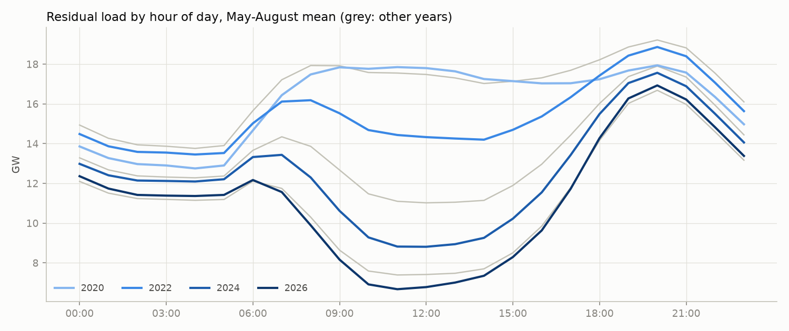
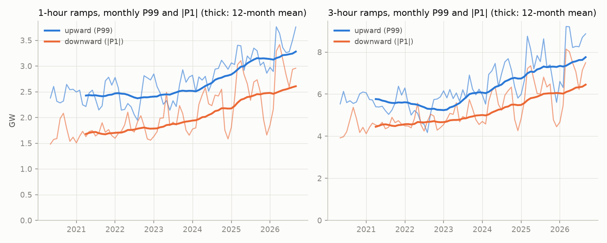
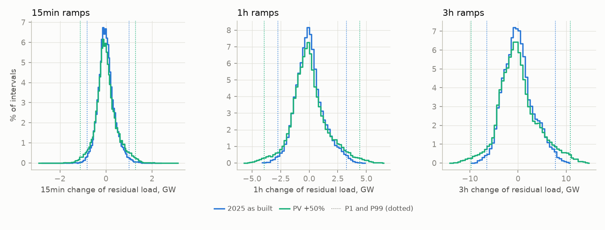
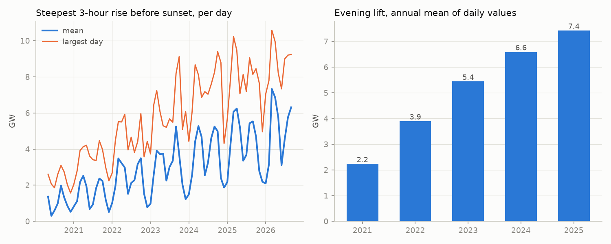
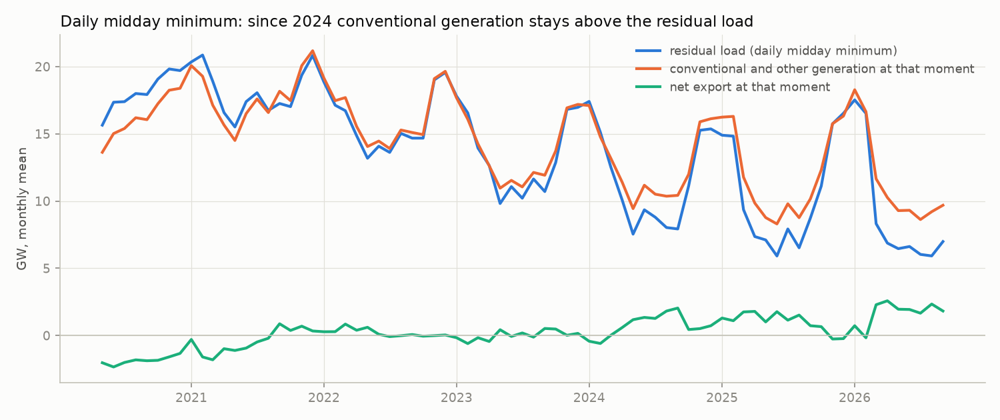
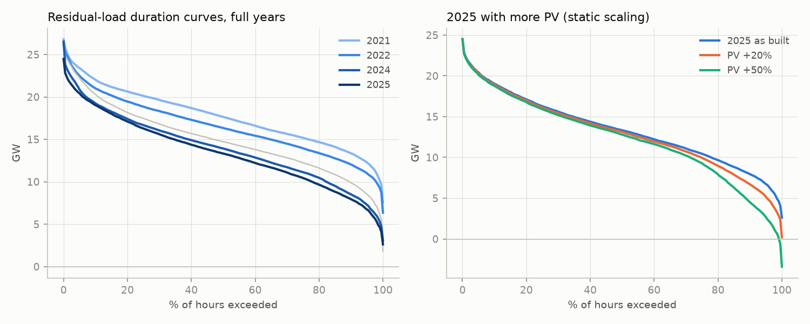
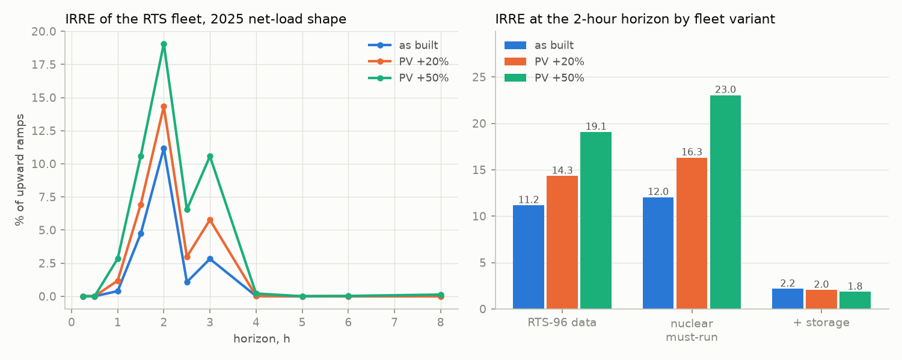
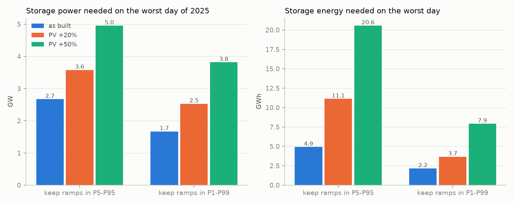

# pl-flexibility-ramps


**Dashboard: https://kwwaleszczynski-del.github.io/pl-flexibility-ramps/**

How much flexibility does the Polish power system need, and how fast is that need growing? This project measures
the **ramps of the residual load** (demand minus PV and wind) in Poland from public data of the transmission system
operator PSE, hourly since May 2020 and every 15 minutes since 14 June 2024: the distribution of 15-minute, 1-hour
and 3-hour changes, the evening ramp after sunset and the midday minimum that presses on must-run units. It then
applies a flexibility metric from the literature (IRRE) to a standard test system fed with the Polish net-load shape,
sizes the storage that would keep the ramps inside their usual range, and repeats both with 20% and 50% more PV.
The topic develops a thread of the author's master's thesis on the reliability of power systems with renewables,
where the classic adequacy indices (LOLE, EENS, ELCC) were set against the newer question of flexibility.



## The problem

Classic adequacy indices such as the loss of load expectation (LOLE) ask whether there is enough capacity to meet
the load. With a lot of solar and wind, a second question becomes as important: can the dispatchable part of the
system follow the *changes* of the load left over for it, and how far down can it go? PV empties the middle of the
day and leaves the evening peak in place, so the remaining units must ramp up quickly when the sun sets (the neck of
the "duck curve") and stay online, at minimum output, through a midday trough that keeps getting deeper. Neither
shows up in LOLE.

## Method

**Data.** Demand, PV and wind generation of the Polish power system (KSE) from two public PSE sources (details in
[Data source](#data-source-and-terms-of-use)): the legacy CSV export of www.pse.pl, hourly, until 13 June 2024, and
the reports API `his-wlk-cal`, every 15 minutes from 14 June 2024. PV generation appears in the legacy export during
2020, so the hourly history starts with the first complete month of PV data. Calendar periods are Polish local time.
For the hourly history the API values are averaged to complete clock hours, so the series is homogeneous; ramp
statistics at 15 minutes use the API period only.

**Residual load and ramps.** With demand $`D_t`$, PV output $`G^{\mathrm{PV}}_t`$ and wind output $`G^{\mathrm{W}}_t`$
(MW), the residual load and its ramp over horizon $`h`$ (15 minutes, 1 hour or 3 hours) are

```math
L_t = D_t - G^{\mathrm{PV}}_t - G^{\mathrm{W}}_t ,
\qquad
\Delta_h L_t = L_{t+h} - L_t
```

A ramp is labelled by its start $`t`$; ramps across missing data are dropped. Upward ramps are described by the
upper tail of the distribution (P95, P99, maximum), downward ramps by the lower tail (P5, P1, minimum).

**Evening ramp and lift.** For every day, the *evening ramp* is the steepest 1-hour and 3-hour rise of
$`L`$ starting in the four hours before sunset (sunset from the NOAA solar-position equations for 52.0° N,
19.4° E, the centre of Poland). The *lift* is the rise from the day's midday minimum (10:00-16:00) to the evening
peak (maximum between one hour before and four hours after sunset): the height of the duck's neck.

**Midday minimum and must-run.** For every day the lowest midday residual load is recorded together with what the
system did at that moment: conventional and other generation (total domestic generation minus PV and wind; API fields
`jg` + `jnwrb` - `pv` - `wi`, legacy `JWCD` + `nJWCD` - PV - wind) and the net exchange (`swm_p` + `swm_np`). If
conventional units could follow the residual load down, the two would match; the gap is exported or, where the data
do not show it, curtailed.

**Trend.** All statistics are computed per calendar month and year. Trends are ordinary least-squares slopes over the
full years.

**Flexibility metric: IRRE.** The insufficient ramping resource expectation was introduced by Lannoye, Flynn and
O'Malley (2012) as the flexibility counterpart of the loss of load expectation: the expected number of observations
in which a system cannot meet a change of the net load. This project implements their high-level screening method
(Lannoye et al., IEEE PES General Meeting 2012) on a stylised system:

* *Fleet*: the 32 generating units of the IEEE Reliability Test System 1979 (3405 MW; unit sizes, MTTF and MTTR
  from RTS-79) with the operating data published with RTS-96: minimum stable output (Table 9), ramp rate and hot
  start-up time (Table 10). The six 50 MW hydro units are energy-limited (200 GWh a year, RTS-96 quarterly
  shares): they shave each day's highest net load and their unused capacity counts as instantaneous flexibility.
* *Net load*: the Polish 15-minute residual load of the reference year, scaled so that its peak demand equals the
  RTS peak of 2850 MW, $`\mathrm{NL}_t = s L_t`$ with $`s = 2850 / \max_t D_t`$.
* *Dispatch*: each observation in merit order (nuclear, coal, #6 oil steam and #2 oil turbines, by full-load heat
  rate); a marginal unit below its minimum stable output (MSO) is raised to it at the expense of the previous unit.
  Ramp limits, start-up costs and reserves do not enter the dispatch, as in the paper's merit-order method.
* *Flexibility* of unit $`r`$ over horizon $`i`$ (minutes), online and offline (paper's eq. 2-3), and the deficit:

```math
F^{\mathrm{on}}_{t,i,r} = \min\left(RR_r \, i ,\; P^{\max}_r - P_{t,r}\right) ,
\qquad
F^{\mathrm{off}}_{t,i,r} = \min\left(RR_r \,(i - T^{\mathrm{start}}_r) ,\; P^{\max}_r\right) \quad (i \ge T^{\mathrm{start}}_r)
```

```math
D_{t,i} = \left(\mathrm{NL}_{t+i} - \mathrm{NL}_t\right) - \sum_r F_{t,i,r} - F^{\mathrm{hydro}}_t - F^{\mathrm{storage}}
```

* *IRRE* counts the upward ramps with $`D_{t,i} > 0`$. Forced outages enter through the all-available state and the
  26 single-outage states of the thermal units, weighted by
  $`c_0 = \prod_r (1 - q_r)`$ and $`c_r = q_r \prod_{j \ne r} (1 - q_j)`$ (paper's eq. 5-7, $`q`$ the forced outage
  rate). Results are given as a percentage of upward ramps and as expected hours per year.
* *Variants*: the RTS-96 data as published (the nuclear units may then ramp at 20 MW/min down to 100 MW), the
  nuclear units as must-run at full output (as in the RTS-GMLC update), and the RTS-96 fleet plus storage of the
  power found below, scaled by $`s`$, assumed available at all times (the paper's assumption for storage).

For comparison the loss of load expectation of the same fleet is computed from an exact capacity outage
probability table (the code reproduces the RTS-79 reference value of 9.394 h/year with the RTS-79 load model).

**How much storage.** For each day of the reference year a linear programme (HiGHS via SciPy) finds the smallest
storage power and, at that power, the smallest energy that keep all 15-minute, 1-hour and 3-hour ramps of the
residual load seen by the rest of the system inside a band, either the P5-P95 or the P1-P99 range of the reference
year's own ramps. With charge $`c_t`$, discharge $`d_t`$ and state of charge $`e_t`$:

```math
L'_t = L_t + c_t - d_t ,
\qquad
\underline{\Delta}_h \le L'_{t+h} - L'_t \le \overline{\Delta}_h ,
\qquad
e_t = e_{t-1} + \Delta t \left(\sqrt{\eta}\, c_t - d_t / \sqrt{\eta}\right)
```

with $`0 \le c_t, d_t \le P`$, $`0 \le e_t \le E`$, round-trip efficiency $`\eta = 0.85`$ and the state of charge
back at its starting level at the end of each day. Days are independent, so the largest daily power and the largest
daily energy together cover every day. The band stays fixed in the PV scenarios: it stands for the ramps the rest
of the system already handles.

**More PV.** The scenarios multiply the observed 15-minute PV profile of the reference year by 1.2 and 1.5 and keep
demand and wind as observed.

## Results

Snapshot of 21 October 2026: hourly history from May 2020 (full years 2021-2025), 15-minute data from 14 June 2024,
reference year for the 15-minute, IRRE and storage analysis 2025. All tables are in [`results/`](results/).

### Ramps are getting steeper

| Hourly data | 2021 | 2022 | 2023 | 2024 | **2025** | 2026 (to 21 Oct) |
|---|---:|---:|---:|---:|---:|---:|
| PV share of demand | 2.6% | 5.4% | 8.0% | 10.6% | **12.1%** | 16.6% |
| Wind share of demand | 8.7% | 10.9% | 13.3% | 14.6% | **13.8%** | 12.8% |
| 1-hour rise, P99, GW | 2.50 | 2.47 | 2.58 | 2.88 | **3.17** | 3.46 |
| 1-hour fall, P1, GW | -1.72 | -1.80 | -2.00 | -2.31 | **-2.62** | -2.98 |
| 3-hour rise, P99, GW | 5.64 | 5.58 | 6.19 | 7.04 | **7.69** | 8.65 |
| Largest 3-hour rise, GW | 7.07 | 7.62 | 9.12 | 9.40 | **10.23** | 10.64 |
| Evening ramp (steepest 3-hour rise before sunset), mean of days, GW | 1.53 | 2.30 | 2.98 | 3.62 | **4.30** | 5.10 |
| Evening lift (midday minimum to evening peak), mean of days, GW | 2.23 | 3.90 | 5.44 | 6.59 | **7.42** | 9.13 |
| Midday minimum of the residual load, mean of days, GW | 18.2 | 15.9 | 13.4 | 11.5 | **10.5** | 8.9 |
| Days with a midday minimum below 5 GW | 0 | 0 | 7 | 20 | **34** | 56 |

**Between 2021 and 2025 the PV share of demand rose from 2.6% to 12.1%, and the ramps followed.** The P99 of hourly
rises grew by about 175 MW a year (OLS over the five full years), the P99 of 3-hour rises by about 555 MW a year, and
falls widened even faster than rises (the P1 of hourly changes by 230 MW a year): the morning drop as PV comes up is
now as much a flexibility task as the evening rise. The 2026 values (January to 21 October, without the winter
months) continue the trend.

On 15-minute data, 2025 had rises of up to **2.39 GW in 15 minutes**, **4.84 GW in one hour** (both starting on
Sunday 21 September 2025 at 15:45) and **10.51 GW in three hours** (from 14:00 on 20 March 2025); the P99 values
were 1.00 GW, 3.24 GW and 7.79 GW. Falls reached 2.77 GW in 15 minutes and 9.87 GW in three hours (2 October 2025
from 07:30). Hourly averaging hides only a little of this: the 1-hour P99 on 15-minute data is 2% higher than on
hourly means, the largest 1-hour rise 5% higher.



With **20% or 50% more PV** (2025 profiles, everything else fixed) the 1-hour P99 rises from 3.24 GW to 3.70 GW and
4.42 GW, the 3-hour P99 from 7.79 GW to 9.04 GW and 10.91 GW, and the largest 3-hour rise from 10.5 GW to 14.7 GW.



### The evening ramp

The mean evening ramp almost tripled between 2021 and 2025 (1.53 GW to 4.30 GW, about +690 MW a year) and the lift
from the midday minimum to the evening peak more than tripled (2.2 GW to 7.4 GW, +1.3 GW a year). The largest day
of 2025 needed 10.2 GW more residual load within three hours before sunset. On 15-minute data the 2025 mean evening
ramp is 5.15 GW (the hourly grid has fewer possible start times); with +50% PV it would be 7.33 GW, with a lift of
11.2 GW on an average day.



### The midday minimum and the must-run floor

The mean midday minimum of the residual load fell from 18.2 GW in 2021 to 10.5 GW in 2025, about 2 GW a year; its
lowest hourly value so far was 1.83 GW (Sunday 8 October 2023, 12:00), and on 15-minute data 2.19 GW (24 August
2025, 09:45). Conventional and other non-PV, non-wind generation did not go as far: at the daily midday minimum it
averaged 17.8 GW in 2021 and 12.0 GW in 2025, and its lowest hourly value in a year only went from 9.1 GW to 6.8 GW.
Until 2023 the two lines moved together; since 2024 the conventional fleet stays above the residual load at midday
(by 1.5 GW on average in 2025) and the surplus is exported (net export at that moment 1.0 GW in 2025 and 1.75 GW in
2026; the identity demand = generation + net import holds in these reports only to within a few hundred MW). This is
consistent with must-run pressure: units kept online for the evening peak and for system services, together with
combined heat and power, set a floor that the midday residual load now regularly undercuts.



With 50% more PV the 2025 residual load would fall below zero in 317 quarter-hours (to -3.9 GW) and the midday
minimum would drop below 5 GW on 180 days instead of 37.



### IRRE on the RTS test system

| IRRE, % of upward ramps (expected hours a year) | 1 h | 2 h | 3 h |
|---|---:|---:|---:|
| RTS-96 data, 2025 net load as built | 0.4 (16) | **11.2 (457)** | 2.8 (115) |
| RTS-96 data, PV +20% | 1.2 (48) | 14.3 (578) | 5.8 (232) |
| RTS-96 data, PV +50% | 2.8 (113) | 19.1 (755) | 10.6 (415) |
| nuclear must-run, as built / PV +50% | 0.4 / 4.3 | 12.0 / 23.0 | 3.4 / 13.7 |
| RTS-96 data + storage (182 / 416 MW), as built / PV +50% | 0.0 / 0.0 | 2.2 / 1.8 | 0.4 / 1.2 |

The RTS fleet, dispatched in merit order against the Polish 2025 net-load shape, cannot meet **11% of the upward
ramps at the 2-hour horizon** (457 hours a year, outage-weighted). The peak sits exactly at the start-up time of
the oil steam units, which add nothing at that horizon and their full output half an hour later; the smaller peak at
3 hours is the start-up time of the smaller coal units, and from 4 hours almost every ramp can be met. The
deficits fall in two windows: the morning rise (ramps starting at 04:00-05:00) and the afternoon-to-evening rise
(starting 12:00-17:00); none at night. More PV raises the 2-hour IRRE to 14% and 19%; fixing the nuclear units at
full output raises it further. Storage at the power found below (the P1-P99 band, scaled to the RTS system: 182 MW
as built, 416 MW with +50% PV) removes most of the deficit.

The same fleet with each year's net-load shape (hourly data, scaled to the same peak) shows the difference between
adequacy and flexibility that motivated the thesis chapter:

| | 2021 | 2022 | 2023 | 2024 | 2025 |
|---|---:|---:|---:|---:|---:|
| LOLE of the RTS fleet, h/year | 10.6 | 7.1 | 5.8 | 1.3 | 2.4 |
| IRRE at 2 h, % of upward ramps | 4.0 | 3.2 | 5.2 | 5.9 | 10.6 |
| IRRE at 3 h, % of upward ramps | 0.04 | 0.03 | 0.27 | 0.53 | 2.59 |

**As PV and wind grew, the loss of load expectation of the same fleet fell by three quarters while its 2-hour IRRE
more than doubled.** Renewables take load off the peak hours that drive LOLE and put it into the ramps that drive
IRRE.



### How much storage

Storage that keeps every 15-minute, 1-hour and 3-hour ramp of 2025 inside the band of 2025 itself (worst day of the
year; in brackets the 95th percentile of the days):

| Band kept | PV as built | PV +20% | PV +50% |
|---|---:|---:|---:|
| P1-P99: power, GW | **1.67** (0.98) | 2.53 (1.73) | **3.82** (2.93) |
| P1-P99: energy, GWh | **2.16** (1.12) | 3.67 (2.65) | **7.91** (5.41) |
| P5-P95: power, GW | 2.67 (1.98) | 3.58 (2.78) | 4.96 (4.07) |
| P5-P95: energy, GWh | 4.92 (3.73) | 11.12 (6.26) | 20.56 (12.06) |
| Energy discharged in the year, P1-P99 / P5-P95, TWh | 0.14 / 0.93 | 0.44 / 1.82 | 1.42 / 3.76 |

The bands are those of 2025: 15 minutes -0.81 to +1.00 GW (P1-P99) or -0.55 to +0.64 GW (P5-P95), 1 hour -2.73 to
+3.24 GW or -1.83 to +2.26 GW, 3 hours -6.53 to +7.79 GW or -4.53 to +5.66 GW. **Cutting off the top and bottom
percent of 2025's ramps would have needed about 1.7 GW and 2.2 GWh of storage; with 50% more PV the same band needs
3.8 GW and 7.9 GWh**, and holding the tighter P5-P95 band with 50% more PV about 5 GW and 21 GWh. Energy grows faster
than power because with more PV the excess ramps last longer: the ratio of the largest daily energy to the largest
daily power rises from 1.3-1.8 hours as built to 2.1-4.1 hours with +50% PV.



### Context: the PSE flexibility needs assessment

In July 2026 PSE published the first national flexibility needs assessment under Article 19e of Regulation (EU)
2019/943 (approved by the President of URE; ERAA 2024 data, hourly, 36 weather years x 15 outage draws). Its
Table 16 gives the hourly change of the residual load for 2030 and 2035. Compared with what was observed (MW/h):

| Hourly change of residual load | PSE 2030 | PSE 2035 | observed 2025 (hourly) | observed 2025 (15-minute data) | 2025 with PV +50% (hourly) |
|---|---:|---:|---:|---:|---:|
| P1 | -4,056 | -5,371 | -2,618 | -2,729 | -3,828 |
| P5 | -2,624 | -3,421 | -1,741 | -1,828 | |
| P95 | 3,165 | 3,937 | 2,212 | 2,257 | |
| P99 | 4,567 | 5,744 | 3,170 | 3,244 | 4,313 |
| maximum | 12,351 | 17,602 | 4,628 | 4,841 | 6,127 |

The observed 2025 P99 is about 70% of PSE's 2030 value, and 2025 with 50% more PV comes close to it. PSE's maxima
are far larger, as expected from 540 simulated years with forced outages and from a residual load that subtracts all
non-dispatchable generation, not only PV and wind, so the comparison is indicative. Other findings of the assessment
for scale: no uncovered downward ramping needs, uncovered upward ramping needs of about 6 GWh a year in 2030 and
56 GWh in 2035, RES curtailment of 0.81 TWh (2030) and 3.28 TWh (2035), and about 16 GWh of storage (roughly 8 GW of
2-hour, 4 GW of 4-hour or 2 GW of 8-hour storage) to reach the 2035 renewables target in all weather years. PSE
notes itself that hourly resolution underestimates ramping needs compared with 15 minutes; the observed difference
in 2025 is small for the P99 (2%) and larger for the extremes (5%). These values are copied from the report and
should be checked against its current version
([PSE, 29 July 2026](https://www.pse.pl/-/sprawozdanie-na-temat-szacowanych-potrzeb-w-zakresie-elastycznosci)).

The [dashboard](https://kwwaleszczynski-del.github.io/pl-flexibility-ramps/) shows all charts interactively in light
and dark mode, including a month-by-time-of-day map of when the system ramps, with annual and monthly tables and CSV
downloads.

## Limitations

- **Observed, not required.** The ramps are those the system actually ran, after exports, imports, curtailment and
  balancing actions; they describe the flexibility that was used, not the flexibility that would have been needed
  without those actions. Net exchange is shown at the midday minimum; curtailment (non-market redispatch of PV and
  wind) is not in these reports.
- **Hourly history.** Before 14 June 2024 only hourly values exist, so 15-minute ramps cover two years and a bit.
  Hourly means smooth the steepest changes: in the reference year the largest 1-hour rise is about 5% higher on
  15-minute data than on hourly means.
- **Data definitions.** PSE reports PV and wind as totals of units on and off the balancing market; how the output
  of small distributed units is estimated is not documented in the reports. The legacy and the new reports are
  stitched at 14 June 2024 without an overlapping day; daily means on both sides of the seam are continuous.
- **Evening and midday windows.** Fixed windows (four hours before sunset, 10:00-16:00) and one sunset time for the
  whole country.
- **IRRE is a test-system exercise.** The fleet is the IEEE RTS, not the Polish fleet, and the merit-order dispatch
  is non-chronological, without reserves, minimum up and down times, ramp limits in the dispatch itself or
  interconnectors. Hot start-up times are used for every offline unit. The hydro units' headroom counts in full
  although their energy is limited, and storage in the IRRE variant is assumed available at any moment. The peaks of
  the IRRE curve sit at the start-up times of the oil steam units (2 h) and the smaller coal units (3 h), as the
  paper's test system shows peaks at its units' start-up times; their height depends on these assumptions. Scaling the Polish net load to the RTS peak keeps its shape,
  not the size ratio between ramps and units of the real system.
- **Storage sizing.** One day at a time with perfect foresight and the state of charge back at its start every
  day; no grid constraints, no market behaviour and no other flexibility reacting. The band is a choice (P5-P95 or
  P1-P99 of the reference year), not a technical limit of the Polish fleet. The worst day sets the requirement, so
  the power and energy figures are driven by a few extreme days; the P95 of the days is given as well.
- **More PV.** The scenarios scale the observed PV profile (same weather, same mix of orientations and the same
  curtailment pattern) and keep demand, wind and everything else fixed.

Grid codes, market rules and the planning documents quoted here change often and should be checked against current
sources before reusing these results.

## Data source and terms of use

All data are public information of **PSE S.A.** (Polskie Sieci Elektroenergetyczne, the Polish transmission system
operator), downloaded without a key:

| Source | Report / fields | Period | Meaning |
|---|---|---|---|
| reports API `https://api.raporty.pse.pl/api` | `his-wlk-cal`: `demand` | from 14 Jun 2024, 15 min | demand of the national power system, MW |
| | `pv`, `wi` | | total generation of PV and wind sources (units on and off the balancing market), MW |
| | `jg`, `jnwrb` | | generation of units active / not active on the balancing market; their sum is total domestic generation |
| | `swm_p`, `swm_np` | | balance of synchronous and asynchronous cross-border exchange, + = import |
| legacy CSV export `https://www.pse.pl/getcsv/-/export/csv/<report>/data_od/<from>/data_do/<to>` | `PL_WYK_KSE`: national demand, generation of JWCD and nJWCD units, exchange balances | hourly, until 13 Jun 2024 | |
| | `PL_GEN_WIATR`: generation of wind and PV sources | hourly, PV from 2020 | |

Both sources are read with [pse-opendata](https://pypi.org/project/pse-opendata/). In the API `dtime_utc` is the
**end** of each 15-minute interval; the library converts it to the interval start. The legacy export serves local
dates and hours 1-24 (the spring day has no hour 2, the extra autumn hour is `2A`); every row is placed by its hour
label, and the export is requested one month at a time with a pause, because the server answers HTTP 429 to quick
series of requests. The download is about 7.5 MB and is cached as monthly Parquet files in `data/`, which is not part
of the repository.

**Terms of use.** PSE publishes conditions for re-using public sector information
([www.pse.pl, BIP, "Ponowne wykorzystywanie informacji sektora publicznego"](https://www.pse.pl/bip/ponowne-wykorzystanie-informacji-publicznej),
checked on 21 October 2026).
They allow commercial and non-commercial re-use of information published on www.pse.pl free of charge, on condition
that the user names the source and the date the information was obtained, removes the PSE logo, and, when the
information has been processed, tells recipients that it was changed and how, without misleading them. PSE accepts
no liability for processed information and notes that some materials may be protected by copyright or database
rights. The conditions are written for www.pse.pl; this project applies them to the reports API of the same operator
as well. Attribution as required:

> Information obtained from www.pse.pl (PSE S.A. reports `his-wlk-cal`, `PL_WYK_KSE`, `PL_GEN_WIATR`), state as of
> 21 October 2026. The information has been processed in whole or in part: residual load computed, aggregated to
> daily, monthly and annual statistics, combined across reports and used in models. It is not an official PSE
> publication.

The repository contains no raw PSE data, only derived statistics in `results/` and `docs/`.

## Usage

```bash
python -m venv .venv
.venv/Scripts/python -m pip install -e ".[dev]"      # Linux/macOS: .venv/bin/python

python -m flex_ramps fetch                            # download the PSE data into data/ (the legacy part takes ~1-2 h)
python -m flex_ramps report                           # tables in results/, README figures in docs/img/
python -m flex_ramps dashboard --out docs             # static page docs/index.html
python -m flex_ramps report --offline --today 2026-10-21 --base-year 2025   # rebuild from the cache
pytest -q                                             # synthetic data, no network
```

```
src/flex_ramps/
  pse_api.py      his-wlk-cal through pse-opendata, data status
  pse_legacy.py   legacy CSV export through pse-opendata (PL_WYK_KSE, PL_GEN_WIATR), hourly history
  data.py         15-minute and hourly analysis frames
  ramps.py        residual load, ramps, duration curves, sunset, evening ramp, midday minima
  rts.py          IEEE RTS fleet, merit-order dispatch, IRRE, LOLE
  storage.py      daily linear programme for storage power and energy
  context.py      values quoted from the PSE flexibility needs assessment
  analysis.py     one pass of everything above, summary for results/summary.json
  figures.py      README figures (matplotlib)
  dashboard.py    static HTML page (Plotly.js), light and dark theme
  cli.py          fetch | report | dashboard
```

**GitHub Pages.** `docs/` holds a committed snapshot of the dashboard, so Pages can serve it directly
(Settings > Pages > Deploy from a branch, `main`, `/docs`). To keep it up to date, switch the Pages source to
GitHub Actions and set the repository variable `DASHBOARD_SCHEDULE` to `on`: the workflow
[`dashboard.yml`](.github/workflows/dashboard.yml) then rebuilds the page from PSE data every Monday (and on
Thursdays, which keeps its data cache from expiring); it can also be started by hand. The schedule is off by
default. A run that cannot complete the data deploys nothing and the next run resumes the download.

## References

- E. Lannoye, D. Flynn, M. O'Malley, "Evaluation of Power System Flexibility", *IEEE Transactions on Power Systems*
  27(2), 922-931, 2012, doi:10.1109/TPWRS.2011.2177280.
- E. Lannoye, D. Flynn, M. O'Malley, "Assessment of Power System Flexibility: A High-Level Approach", *IEEE PES
  General Meeting*, 2012, doi:10.1109/PESGM.2012.6345435.
- IEEE Subcommittee on the Application of Probability Methods, "IEEE Reliability Test System", *IEEE Transactions on
  Power Apparatus and Systems* PAS-98(6), 2047-2054, 1979.
- C. Grigg et al., "The IEEE Reliability Test System-1996", *IEEE Transactions on Power Systems* 14(3), 1010-1020,
  1999 (unit data tables at the [University of Washington PSTCA archive](https://adapt.ee.washington.edu/research/pstca/rts/pg_tcarts.htm)).
- C. Barrows et al., "The IEEE Reliability Test System: A Proposed 2019 Update", *IEEE Transactions on Power Systems*
  35(1), 119-127, 2020.
- R. Billinton, R. N. Allan, *Reliability Evaluation of Power Systems*, 2nd ed., Plenum, 1996.
- PSE S.A., *Sprawozdanie na temat szacowanych potrzeb w zakresie elastyczności w odniesieniu do lat 2030 i 2035 dla
  Krajowego Systemu Elektroenergetycznego*, 29 July 2026, [pse.pl](https://www.pse.pl/-/sprawozdanie-na-temat-szacowanych-potrzeb-w-zakresie-elastycznosci).
- NOAA Global Monitoring Laboratory, *General Solar Position Calculations* (sunset equations).

## License

Code: MIT, see [LICENSE](LICENSE). Data: PSE S.A. public information, see [Data source and terms of use](#data-source-and-terms-of-use).
